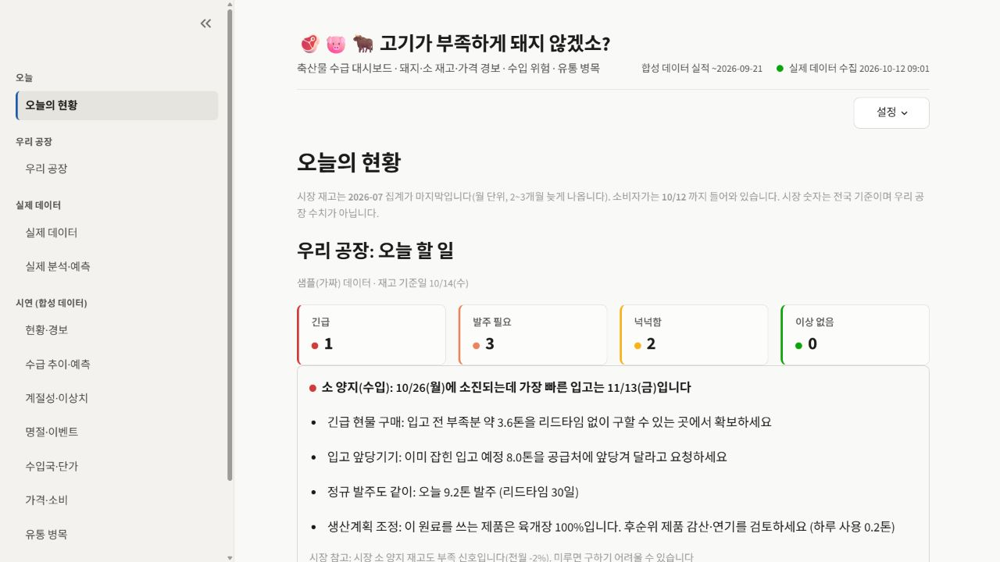
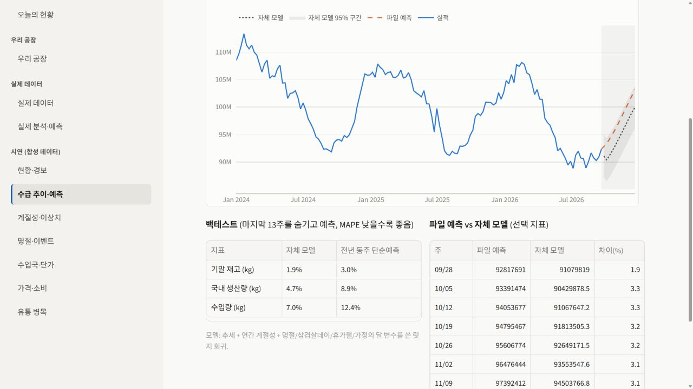

<div align="center">

# 고기가 부족하게 돼지 않겠소?

**시장 신호에서, 우리 공장의 다음 발주까지.**<br>
돼지·소의 재고와 가격을 살피고 원료 소진일·발주 시점·발주량을 계산하는 수급 대시보드

`Python` · `Streamlit` · `pandas · Plotly` · `공공데이터 API` · `시계열 분석`

[화면과 기능](#화면으로-보는-핵심-기능) · [설계 의도](#설계에서-고민한-점) · [실행 방법](#실행-방법) · [분석 노트](docs/ANALYSIS_NOTES.md)

</div>



> 실제 브라우저 실행 화면입니다. **공장 수치는 가짜 샘플**, 시장 참고 정보는 수집된 공공데이터입니다. 화면에 표시된 날짜 기준의 예시이며 실시간 시황이나 실제 발주 지시가 아닙니다.

## 왜 만들었나요?

생산·재고 관리에서는 가격이 올랐다는 정보만으로 다음 행동을 결정하기 어렵습니다. **현재 원료가 며칠 버티는지, 입고까지 얼마나 걸리는지, 생산계획을 맞추려면 언제 몇 톤을 주문해야 하는지**를 함께 봐야 합니다.

이 프로젝트는 공공데이터를 수집·분석하는 데서 시작해, 재고·입고 예정·생산계획·배합표 CSV를 연결하고 **“오늘 확인할 일”로 바꾸는 과정**까지 구현했습니다. 실제 공장에 도입된 시스템이 아닌 학습·포트폴리오용 개인 프로젝트입니다.

| 보는 사람 | 넣는 데이터 | 얻는 결과 |
|---|---|---|
| 생산·원료·재고 관리 업무를 살펴보는 사용자 | 공공 재고·가격 + 공장 CSV | 시장 경보, 소진 예정일, 발주 기한·수량, 행동 안내 |

## 화면으로 보는 핵심 기능

### 01. “재고 부족”을 날짜와 수량으로 풀어 보기

대표 화면의 `오늘의 현황`은 긴급·발주 필요·넉넉함 등의 상태와 원료별 행동을 보여 줍니다. 예를 들어 **소진일보다 가장 빠른 입고일이 늦으면**, 긴급 구매·입고 앞당기기·정규 발주·생산계획 조정을 나누어 안내합니다.

시장 재고와 소비자가는 참고 신호로 덧붙입니다. 전국 시장 재고를 우리 공장 재고로 해석하거나 소비자가를 실제 매입 단가로 쓰지 않도록 구분했습니다.

### 02. 추이와 예측을 보고, 과거 구간에서 성능을 비교하기



위 화면은 **합성 데이터로 분석 방법을 보여 주는 시연**입니다. 추세·계절성·이벤트를 반영한 모델을 만들고, 마지막 13주를 숨겨 예측한 결과를 단순한 전년 동주 기준과 비교합니다. 그래프뿐 아니라 오차 표를 함께 보여 줍니다.

공공데이터 분석은 별도의 `실제 분석·예측` 화면에서 제공합니다. 실제 월 재고 예측은 직전값을 그대로 쓰는 기준선을 이기지 못했고, 그 결과도 [분석 노트](docs/ANALYSIS_NOTES.md)에 남겼습니다.

## 무엇을 볼 수 있나요?

| 영역 | 기능 | 데이터 |
|---|---|---|
| 오늘의 현황 | 우선 확인할 원료, 발주 안내, 시장 신호와 시세 | 공공데이터 + 입력 CSV 또는 샘플 |
| 우리 공장 | CSV 양식·입력 검증, 재고일수·소진일·발주일·발주량, 예상 재고 | 사용자가 넣은 CSV |
| 실제 데이터 | 부위별 재고, 소비자가, 평년 대비, 국산·수입 비교, 경락가, 수집 품질 | 공공 API 누적 데이터 |
| 실제 분석·예측 | 재고·가격 경보, 과거 구간 예측 평가, 가격 반영 시차, 알림 이력 | 공공 API 누적 데이터 |
| 시연 화면 7종 | 현황·추이·계절성·명절·수입국·가격·유통 병목 분석 | 합성 데이터 |

### 우리 공장 CSV 연결

```text
재고 + 입고 예정 + 생산계획 + 배합표
                  ↓
원료별 예상 사용량과 입출고 계산
                  ↓
소진 예정일 · 안전재고 미달일 · 발주 기한 · 필요한 수량
                  ↓
오늘의 현황에 행동 안내
```

처음에는 `우리 공장 → 샘플(가짜) 데이터로 시험`을 누르면 됩니다. 샘플 모드는 실제 회사 파일 없이 계산을 살펴보는 용도입니다. 입력 열과 계산 규칙은 [우리 공장 데이터 안내](docs/COMPANY_DATA.md)에 정리했습니다.

## 설계에서 고민한 점

- **실제·회사·합성 데이터 구분.** 출처, 단위, 주기가 다른 데이터를 한 숫자로 섞지 않고 메뉴와 안내 문구로 나눴습니다.
- **통계를 현장 언어로 표현.** “평소보다 29% 적음”, “오늘까지 4.6톤 발주”처럼 화면에서 의미와 행동을 읽을 수 있게 했습니다.
- **예측은 기준선과 비교.** 복잡한 모델을 썼다는 이유로 더 좋다고 판단하지 않습니다. 오차를 비교하고 성능이 부족하면 그대로 밝힙니다.
- **수집 실패도 데이터의 일부.** 호출 예산, 날짜별 누적 저장, 인증 오류 시 중단, 결측·급변 점검을 둬 수집 상태까지 확인합니다.
- **같은 경보는 반복 발송하지 않기.** 수집 후 새 경보만 Windows 알림과 이력에 남깁니다. 샘플 공장 데이터는 실제 공장 알림에서 제외합니다.

## 실행 방법

### 화면부터 살펴보기

```bash
pip install -r requirements.txt
streamlit run app.py
```

[http://localhost:8501](http://localhost:8501)을 엽니다. API 키가 없어도 합성 데이터 시연과 공장 샘플 계산을 살펴볼 수 있습니다. 수집된 실제 데이터가 없으면 실제 데이터 화면은 별도 수집이 필요합니다.

### 실제 공공데이터 연결 — Windows

```bat
setup.bat
copy .env.example .env
REM .env의 KEY_EKAPE_DISTRIB에 발급받은 키를 입력합니다.
.venv\Scripts\python collect.py
run.bat
```

API 키는 `.env`에만 두며 Git에 포함하지 않습니다. 수집한 실제 데이터는 `data/live/`, 입력한 공장 CSV는 `data/company/`에 보관하며 두 폴더의 운영 데이터도 Git에서 제외합니다.

자동 수집 등록·해제, 경보 설정, 문제 해결 등 기존 상세 사용법은 [운영 안내](docs/OPERATIONS.md)에서 볼 수 있습니다.

## 구조와 검증

| 코드 | 역할 |
|---|---|
| [app.py](app.py) | 메뉴와 분석 화면 |
| [lib/live.py](lib/live.py), [collect.py](collect.py) | 공공 API 수집·누적·품질 점검 |
| [lib/analysis.py](lib/analysis.py), [lib/live_analysis.py](lib/live_analysis.py) | 합성·실제 데이터 분석과 예측 |
| [lib/company.py](lib/company.py), [lib/advice.py](lib/advice.py) | 원료 소진·발주 계산과 행동 안내 |
| [lib/alerts.py](lib/alerts.py) | 경보 규칙, 이력과 중복 방지 |
| [tests](tests/) | 파싱·단위·호출 예산·경보·발주 계산 테스트 |

```bash
python -m pytest -q
```

## 데이터의 한계

실제 재고는 월 단위이며 공개가 약 2~3개월 늦습니다. 표본이 작아 예측은 보조 정보로 사용해야 합니다. 돼지 경락가의 지역 범위, 실제 소비량·유통 마진 등 확보하지 못한 지표도 별도로 밝혔습니다.

공장 계산은 입력한 생산계획·배합표·입고 일정에 의존하며, 대체 부위·원산지 전환·원가 최적화나 실제 주문 실행은 다루지 않습니다. 이 프로젝트의 행동 안내는 의사결정을 돕는 계산 결과입니다.

[분석 과정과 결과](docs/ANALYSIS_NOTES.md) · [지표 대응표](docs/METRIC_MAPPING.md) · [API 조사](docs/API_SURVEY.md) · [화면 설계](docs/DESIGN.md) · [개발 계획](PLAN.md)

생성형 AI와 함께 기획·구현·분석을 진행한 개인 학습 프로젝트입니다.
